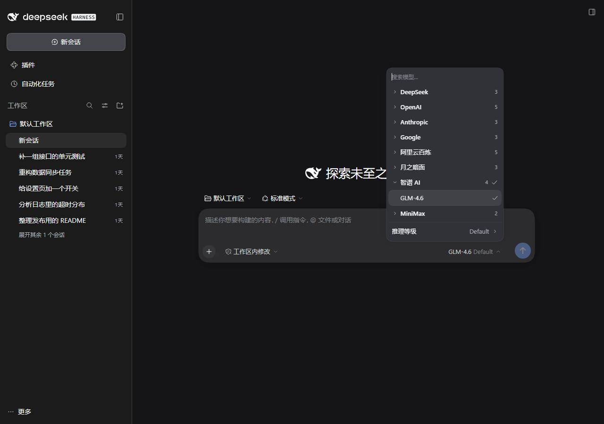
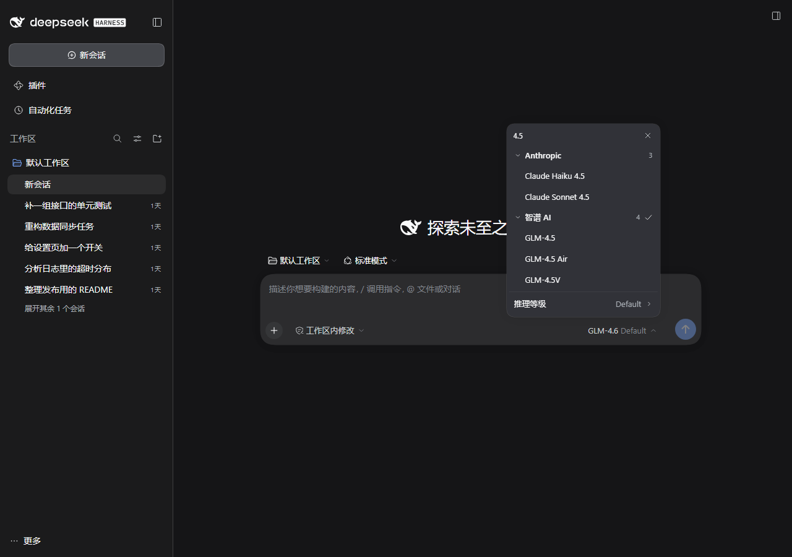
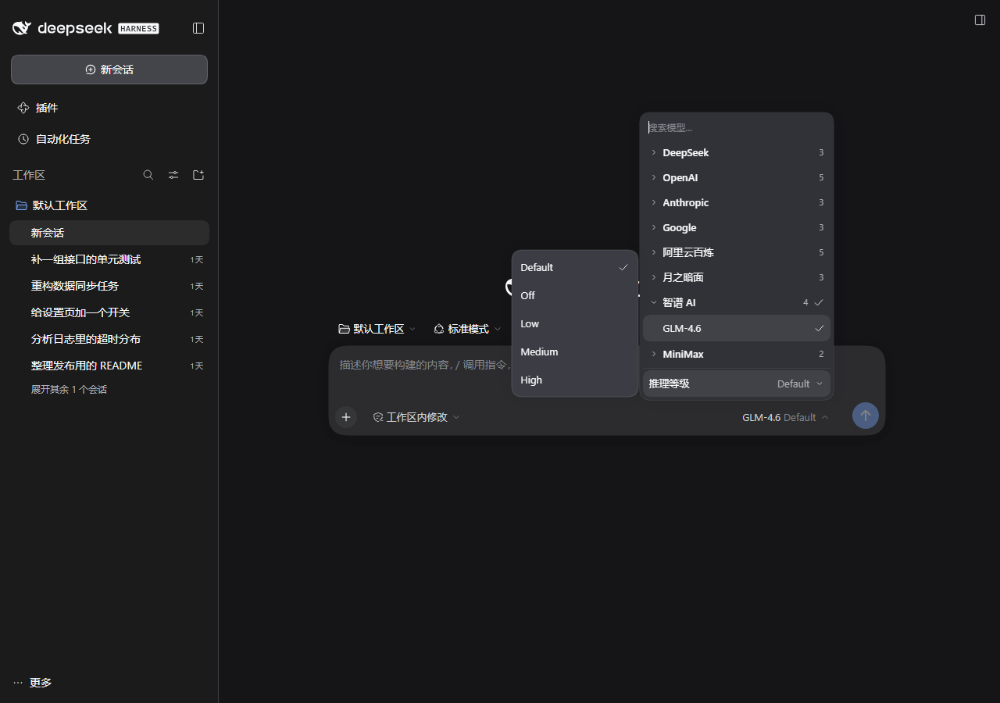

# dsh-model-groups

> A provider-grouped model picker for DeepSeek Harness: **one accordion instead of a wall of models**.

The model menu and the `/model` command now render the same accordion — providers as the first level, their models as the second — with a search box that is always there.

## Copy-paste install

Windows (PowerShell):

```powershell
# 1) clone somewhere permanent (not inside the profile's node_modules)
git clone https://github.com/YMC521/dsh-model-groups.git "$env:USERPROFILE\dsh-plugins\dsh-model-groups"

# 2) link it into the profile: "web" is the browser profile — for the desktop app use your profile dir name
$p = "$env:USERPROFILE\.dsh\profiles\web"
New-Item -ItemType Junction -Path "$p\node_modules\dsh-model-groups" -Target "$env:USERPROFILE\dsh-plugins\dsh-model-groups"

# 3) disable the official entry, insert this plugin
Add-Content "$p\cordis.patch.yml" "`n# dsh-model-groups: upstream of the official picker — both at once would register twice`n- id: ui-model-selection`n  disabled: true`n`n- insert:`n    - id: dsh-model-groups`n      name: dsh-model-groups`n"

# 4) reload the page with Ctrl+F5 — no process restart needed
```

If the link already exists (reinstall/upgrade), remove it first: `Remove-Item "$p\node_modules\dsh-model-groups"`.

macOS / Linux:

```bash
git clone https://github.com/YMC521/dsh-model-groups.git ~/dsh-plugins/dsh-model-groups
PROFILE=~/.dsh/profiles/web          # desktop app: your own profile dir
ln -s ~/dsh-plugins/dsh-model-groups "$PROFILE/node_modules/dsh-model-groups"
cat >> "$PROFILE/cordis.patch.yml" <<'YAML'

# dsh-model-groups: upstream of the official picker — both at once would register twice
- id: ui-model-selection
  disabled: true

- insert:
    - id: dsh-model-groups
      name: dsh-model-groups
YAML
```

Verify: `cd "$p" && node -e "console.log(require.resolve('dsh-model-groups'))"` prints the plugin dir. Rollback: delete those two blocks and the link, reload.







## Why

Once you have seven or eight providers with a few models each, the stock picker becomes a 40+ row flat list:

- every model is flattened together, grouped only by sticky titles, with no folding;
- you scroll from the top every single time;
- the official search box only appears when there are more than four models;
- switching to a provider's second-choice model means locating that provider among dozens of rows first.

This plugin gives that list structure. Default state on open: everything collapsed, only the provider of the current model expanded — and showing just the current model, not its whole family.

## Features

| | |
| --- | --- |
| Provider accordion | Row = provider name + model count + current-model badge; click to expand in place, click again to collapse |
| Collapsed on open | All providers collapsed; the current model's provider opens with only the current model visible |
| Always-on search | Search box always rendered and auto-focused on open; matches expand their provider, non-matching providers disappear entirely |
| Keyboard | ↑↓ to move, Enter to pick, ↓ from the search box enters the list, Esc is a three-step ladder (close effort panel → clear search → close menu) |
| Reasoning effort | Pulled out of the scrolling list into a pinned bar; hovering pops a panel beside the menu (flips to the left when space is short); solid card, not a translucent overlay |
| Same in both entries | The composer model seat and `/model` open the identical accordion |

## Install

Requires a working DeepSeek Harness (web or desktop) and `git`. The block above is the whole route; here is what each step does.

**A. Attach to an existing profile (smallest change)**

1. **Clone somewhere permanent** — not inside the profile's `node_modules`, which dependency tooling may prune:

   ```powershell
   New-Item -ItemType Directory -Force D:\plugins | Out-Null
   git clone https://github.com/YMC521/dsh-model-groups.git D:\plugins\dsh-model-groups
   ```

   Already have a zip or another copy? Just move it there (`Move-Item` on Windows, `mv` elsewhere).

2. **Link it into the profile's `node_modules`** (symlink, so `git pull` upgrades in place and no lockfile changes):

   ```powershell
   New-Item -ItemType Junction -Path "$env:USERPROFILE\.dsh\profiles\web\node_modules\dsh-model-groups" -Target "D:\plugins\dsh-model-groups"
   ```

   ```bat
   mklink /J "%USERPROFILE%\.dsh\profiles\web\node_modules\dsh-model-groups" "D:\plugins\dsh-model-groups"
   ```

   ```bash
   ln -s /path/to/dsh-model-groups ~/.dsh/profiles/web/node_modules/dsh-model-groups
   ```

   > Replace `profiles\web` with the profile you actually run (a directory under `~/.dsh/profiles/`).

3. **Append to `<profile>/cordis.patch.yml`**:

   ```yaml
   - id: ui-model-selection
     disabled: true

   - insert:
       - id: dsh-model-groups
         name: dsh-model-groups
   ```

4. **Hard-refresh the page** (`Ctrl+F5`). The profile patch is watched, so no restart is needed; the browser only has to fetch the new plugin bundle.

**B. Ship it as a bundle**

Add `dsh-model-groups` to `dsh.profile.bundles` in the profile `package.json` and install dependencies (`dsh plugin --profile web install`). The bundled `cordis.patch.yml` disables the official entry and inserts this one — do not edit the profile patch in that case. Use one route, not both.

## Rollback

Delete those two blocks and the link, refresh. Nothing else is touched.

```powershell
Remove-Item "$env:USERPROFILE\.dsh\profiles\web\node_modules\dsh-model-groups"
```

## How it works

- It is a **fork** of the official `@deepseek-ai/dsh-client-ui-model-selection`: `scripts/build.mjs` takes the official `lib/client.js`, swaps the `//#region lib/types/client/ModelSelect.js` region for `src/region.js`, rewrites the package id, CSS module id, component name and the `/model` contribution, and writes `lib/client.js`.
- Registration reuses the official surfaces: slot `conversation.input.model` plus a `commandUi` `/model` contribution; the official row is disabled so nothing renders twice.
- `/model` changes from `popupSelect` to `action`: the official popup shell cannot fold sections, so the command only asks the accordion to open.
- **Surface fill**: the stock menu is a frosted material (`rgba(67,69,74,0.45)` + `backdrop-filter: blur(40px)`). The plugin paints the surfaces opaque with inline `!important` and hides the material layer, so it never depends on theme tokens.

## Development

```bash
MG_SOURCE=/path/to/@deepseek-ai/dsh-client-ui-model-selection/lib/client.js node scripts/build.mjs
node scripts/smoke.cjs                 # no browser needed
npm i -D puppeteer-core
node scripts/e2e/accept.cjs            # accordion, search, Esc, /model
node scripts/e2e/effort.cjs            # effort bar, side panel, keyboard, opacity
```

Env vars: `MG_SOURCE`, `MG_URL` (default `http://127.0.0.1:3080/`), `MG_CHROME`, `MG_PUPPETEER`.

Only edit `src/region.js`; `lib/client.js` is a generated artifact.

## Known limits

- Tied to official internals (region marker, `MenuSurface` CSS module classes, slot name, `commandUi` contribution shape). A major DSH upgrade that moves them makes the build fail loudly (`region markers not found`); sync `src/region.js` accordingly.
- Only the composer model seat and `/model` are taken over; the settings-page model list is still official.
- Copy follows DSH's zh/en locale (only the plugin title/description are added here).

## License

MIT. `lib/client.js` is generated by forking and stitching an official package region — respect the upstream license when redistributing.
